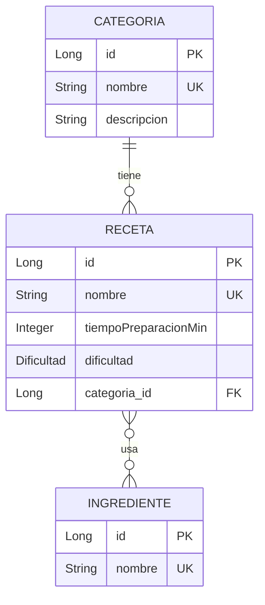

# 🍳 Gestión de Recetas — API REST con Spring Boot

API REST para gestionar **recetas**, **categorías** e **ingredientes**. Proyecto de la asignatura *Acceso a Datos* / *Programación de Servicios y Procesos* (curso 2026-27).

## 📑 Índice

1. [Tecnologías](#-tecnologías)
2. [Requisitos y ejecución](#-requisitos-y-ejecución)
3. [Modelo de datos](#-modelo-de-datos)
4. [Endpoints](#-endpoints)
5. [Validaciones](#-validaciones)
6. [Gestión de errores](#-gestión-de-errores)
7. [Documentación OpenAPI / Swagger](#-documentación-openapi--swagger)
8. [Base de datos H2](#-base-de-datos-h2)
9. [Colecciones de Postman](#-colecciones-de-postman)
10. [Estructura del proyecto](#-estructura-del-proyecto)

---

## 🛠 Tecnologías

| Tecnología | Versión |
|---|---|
| Java | 25 |
| Spring Boot | 4.1.1 |
| Spring Web MVC | — |
| Spring Data JPA | — |
| Bean Validation (Jakarta) | — |
| H2 (base de datos en memoria) | — |
| springdoc-openapi (Swagger UI) | 3.1.1 |
| Lombok | — |
| Maven | wrapper incluido |

---

## 🚀 Requisitos y ejecución

**Requisitos:** JDK 25 instalado (no hace falta instalar Maven, el proyecto incluye el wrapper).

```bash
# 1. Clonar el repositorio
git clone <(https://github.com/perezacmar25-cpu/GestionRecetas.git)>
cd GestionRecetas

# 2. Ejecutar la aplicación
./mvnw spring-boot:run          # Linux / macOS
mvnw.cmd spring-boot:run        # Windows
```

La API queda disponible en **http://localhost:8080**.

> ⚠️ La base de datos es **en memoria**: los datos se pierden al detener la aplicación.

---

## 🗂 Modelo de datos



- **Categoría → Receta**: una categoría tiene muchas recetas (1:N).
- **Receta ↔ Ingrediente**: relación muchos a muchos (tabla intermedia `receta_ingrediente`).
- **Dificultad** (enum): `FACIL`, `MEDIA`, `DIFICIL`.
- Los campos `nombre` de las tres entidades son **únicos**.

---

## 📡 Endpoints

URL base: `/api/v1`

### Categorías — CRUD completo

| Método | Ruta | Descripción | Códigos |
|---|---|---|---|
| `GET` | `/categorias` | Listar todas las categorías | 200 |
| `GET` | `/categorias/{id}` | Obtener una categoría (incluye resumen de sus recetas) | 200, 404 |
| `POST` | `/categorias` | Crear una categoría | 201, 400, 409 |
| `PUT` | `/categorias/{id}` | Actualizar una categoría | 200, 400, 404, 409 |
| `DELETE` | `/categorias/{id}` | Eliminar una categoría | 204, 404 |

### Ingredientes — crear y listar

| Método | Ruta | Descripción | Códigos |
|---|---|---|---|
| `GET` | `/ingredientes` | Listar todos los ingredientes | 200 |
| `POST` | `/ingredientes` | Crear un ingrediente | 201, 400, 409 |

### Recetas — CRUD completo

| Método | Ruta | Descripción | Códigos |
|---|---|---|---|
| `GET` | `/recetas` | Listar todas las recetas | 200 |
| `GET` | `/recetas/{id}` | Obtener una receta con sus ingredientes | 200, 404 |
| `POST` | `/recetas` | Crear una receta (requiere una categoría existente) | 201, 400, 404, 409 |
| `PUT` | `/recetas/{id}` | Actualizar una receta | 200, 400, 404, 409 |
| `DELETE` | `/recetas/{id}` | Eliminar una receta | 204, 404 |

### Relación Receta ↔ Ingrediente (M:M)

| Método | Ruta | Descripción | Códigos |
|---|---|---|---|
| `POST` | `/recetas/{recetaId}/ingredientes` | Añadir un ingrediente existente a una receta | 201, 400, 404, 409 |

El ingrediente se identifica por su `id`; el `nombre` es obligatorio en el cuerpo por la validación del DTO.

### Ejemplos de peticiones

**Crear categoría** — `POST /api/v1/categorias`

```json
{
  "nombre": "Postres",
  "descripcion": "Dulces y postres"
}
```

**Crear ingrediente** — `POST /api/v1/ingredientes`

```json
{
  "nombre": "Harina"
}
```

**Crear receta** — `POST /api/v1/recetas`

```json
{
  "nombre": "Tarta de queso",
  "tiempoDePreparacion": 60,
  "dificultad": "MEDIA",
  "idCategoria": 1,
  "ingredientes": []
}
```

**Añadir ingrediente a una receta** — `POST /api/v1/recetas/1/ingredientes`

```json
{
  "id": 1,
  "nombre": "Harina"
}
```

**Respuesta de `GET /api/v1/recetas/1`**

```json
{
  "id": 1,
  "nombre": "Tarta de queso",
  "tiempoDePreparacion": 60,
  "dificultad": "MEDIA",
  "idCategoria": 1,
  "ingredientes": [
    { "id": 1, "nombre": "Harina" }
  ]
}
```

---

## ✅ Validaciones

| Campo | Regla |
|---|---|
| `Categoria.nombre` | `@NotBlank`, único |
| `Ingrediente.nombre` | `@NotBlank`, único |
| `Receta.nombre` | `@NotBlank`, único |
| `Receta.tiempoDePreparacion` | `@NotNull` y mayor que cero |
| `Receta.dificultad` | `@NotNull` (`FACIL`, `MEDIA` o `DIFICIL`) |
| `Receta.idCategoria` | `@NotNull` y debe corresponder a una categoría existente |
| `Receta.ingredientes` | `@Valid`: se validan también los ingredientes anidados |

### Validación personalizada: `@TiempoCoherente`

Anotación propia aplicada sobre `RecetaDto` que comprueba que el tiempo de preparación **sea coherente con la dificultad**:

> Una receta `FACIL` no puede superar los **60 minutos**.

Está implementada con `@TiempoCoherente` + `TiempoCoherenteValidator` (paquete `Validation`) y se ejecuta tanto en el `POST` como en el `PUT` de recetas.

| Dificultad | Tiempo | Resultado |
|---|---|---|
| `FACIL` | 60 | ✅ Válida |
| `FACIL` | 61 o más | ❌ 400 |
| `MEDIA` / `DIFICIL` | cualquier tiempo > 0 | ✅ Válida |

---

## ⚠️ Gestión de errores

Todos los errores se devuelven en formato **`ProblemDetail`** (RFC 9457), centralizados en `GlobalExceptionHandler`.

| Excepción | Código | Cuándo se lanza |
|---|---|---|
| `CategoriaNotFoundException` | **404** | La categoría no existe |
| `RecetaNotFoundException` | **404** | La receta no existe |
| `IngredienteNotFoundException` | **404** | El ingrediente no existe |
| `TiempoInvalidoException` | **400** | El tiempo de preparación es menor o igual a cero |
| `MethodArgumentNotValidException` | **400** | Falla una validación del cuerpo (`@NotBlank`, `@NotNull`, `@TiempoCoherente`…) |
| `CategoriaRepetidaException` | **409** | Ya existe una categoría con ese nombre |
| `RecetaNombreDuplicadoException` | **409** | Ya existe una receta con ese nombre |
| `IngredienteRepetidoException` | **409** | Ya existe un ingrediente con ese nombre |
| `IngredienteAlredyAddedException` | **409** | El ingrediente ya está añadido a esa receta |

**Decisión de diseño:** los conflictos por duplicado devuelven **409 Conflict** (el recurso ya existe) y no 400, porque la petición está bien formada pero choca con el estado actual de los datos.

**Ejemplo de error 409**

```json
{
  "type": "https://example.com/errors/categoria-repetida",
  "title": "Categoría repetida",
  "status": 409,
  "detail": "Ya existe una categoría con el nombre Postres",
  "instance": "/api/v1/categorias"
}
```

**Ejemplo de error 400 por validación**

```json
{
  "type": "about:blank",
  "title": "Bad Request",
  "status": 400,
  "detail": "Error de validación",
  "instance": "/api/v1/recetas",
  "invalid-params": [
    {
      "object": "recetaDto",
      "message": "Una receta FACIL no puede superar los 60 minutos"
    }
  ]
}
```

---

## 📖 Documentación OpenAPI / Swagger

Con la aplicación en marcha:

- **Swagger UI:** http://localhost:8080/swagger-ui.html
- **Especificación OpenAPI (JSON):** http://localhost:8080/v3/api-docs

Todos los endpoints, incluidos los de la relación M:M, están documentados con sus códigos de respuesta.

---

## 🗄 Base de datos H2

Consola web: http://localhost:8080/h2-console

| Parámetro | Valor |
|---|---|
| JDBC URL | `jdbc:h2:mem:recetasdb` |
| Usuario | `sa` |
| Contraseña | *(vacía)* |

---

## 📬 Colecciones de Postman

En la carpeta `postman/` hay una colección por recurso y un entorno:

| Archivo | Contenido |
|---|---|
| `Categorias.postman_collection.json` | CRUD de categorías y casos de error |
| `Ingredientes.postman_collection.json` | Crear y listar ingredientes |
| `Recetas.postman_collection.json` | CRUD de recetas, añadir ingredientes y casos de error |
| `Entorno.postman_environment.json` | Variables `baseUrl` y ids |

**Cómo usarlas**

1. Importar los cuatro archivos en Postman (**Import**).
2. Seleccionar el entorno **GestionRecetas - Local**.
3. Con la aplicación arrancada, ejecutar las colecciones en este orden: **Categorías → Ingredientes → Recetas**.
4. Dentro de cada colección, lanzar las peticiones de arriba abajo: los ids se guardan automáticamente en el entorno.

---

## 📁 Estructura del proyecto

```
src/main/java/com/example/salesianos/gestionrecetas
├── Controller     # Endpoints REST + documentación OpenAPI
├── Dto            # DTOs (RecetaDto incluye IngredienteDto anidado)
├── Error          # Excepciones propias y GlobalExceptionHandler
├── Model          # Entidades JPA y enum Dificultad
├── Repository     # Repositorios Spring Data JPA
├── Service        # Lógica de negocio
└── Validation     # Anotación de validación personalizada
```

---

## 👤 Autor

Proyecto realizado de forma individual — *Mario Pérez Acosta*.
